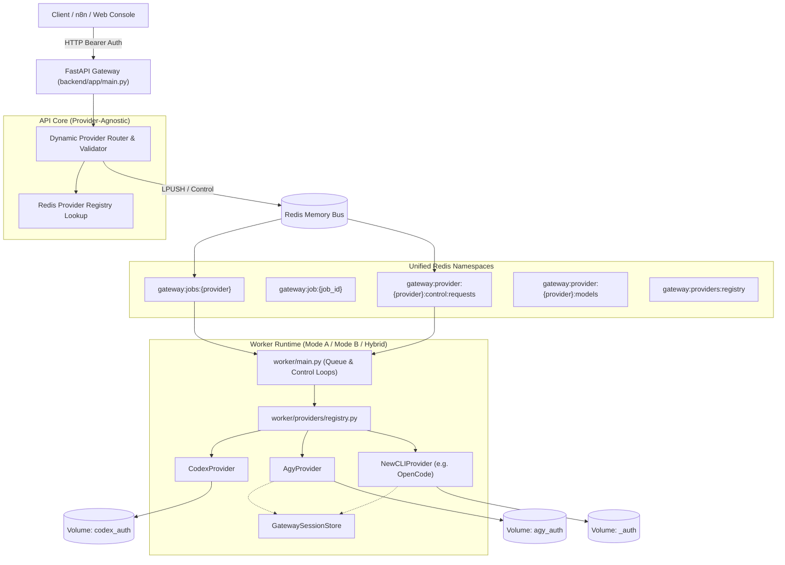

# Software Architecture: Extensible Multi-CLI Gateway

เอกสารนี้อธิบายสถาปัตยกรรมซอฟต์แวร์ของ **AI CLI Gateway** สำหรับรองรับการนำ AI CLI ค่ายต่างๆ เข้ามาทำงานร่วมกันในแนวทางเดียว (Provider-Agnostic Core + Adapter Pattern) และรองรับการรันทั้งแบบ **Unified Worker (Mode A)**, **Dedicated Worker per CLI (Mode B)**, หรือแบบ **Hybrid**

---

## 1. ภาพรวมสถาปัตยกรรม (System Overview)

---

## 2. โครงสร้างโมดูลหลัก (Component Breakdown)

### 2.1 Backend API (`backend/app/`)
- **`backend/app/main.py`**:
  - **Provider-Agnostic Endpoints**: ไม่มี `Literal` ที่ผูกชื่อค่ายแบบตายตัว ทุก route (`/v1/models`, `/v1/chat/completions`, `/v1/jobs`, `/admin/usage`, `/admin/sessions`) อ่านรายการค่ายจาก `get_registered_providers()`
  - **`GET /v1/providers`**: คืนรายการ provider ที่ active พร้อม `display_name`, `default_model_alias`, และ `capabilities` ให้ Frontend ใช้สร้าง UI แบบ dynamic
  - **Routing & Default Model**: `resolve_provider()` รองรับรูปแบบ `<provider>:<model_id>` และ `<provider>-default` โดยค่า default model อ่านจาก `DEFAULT_MODEL` (Codex), `AGY_DEFAULT_MODEL` (Agy), หรือ `<PROVIDER>_DEFAULT_MODEL` สำหรับค่ายใหม่
  - **Version Tracking**: `GET /health` และ `GET /admin/overview` ส่งหมายเลขเวอร์ชันของ API (`gateway_version`)
- **`backend/app/common.py`**:
  - จัดการ Redis pipeline สำหรับ `enqueue()` / `fetch()` และ `control_request()` ผ่านโปรโตคอลกลาง

### 2.2 Worker & Provider Package (`worker/`)
- **`worker/main.py`**:
  - โหลดเฉพาะ provider ที่ระบุใน `ENABLED_PROVIDERS` ผ่าน `build_registry()`
  - ลงทะเบียน capabilities ของทุก provider ลงใน `gateway:providers:registry` ตอน startup (`register_providers()`)
  - รัน `control_loop(provider_name)` 1 thread ต่อค่าย และ `loop()` สำหรับ `BRPOP` จาก `gateway:jobs:{provider}`
- **`worker/providers/base.py`**:
  - **`ProviderCapabilities`**: ประกาศความสามารถของ CLI (`modes`, `default_mode`, `supports_system_prompt`, `supports_sessions`, `supports_session_history`, `supports_session_delete`, `supports_usage_quota`, `supports_model_discovery`, `session_list_modes`)
  - **`BaseCLIProvider`**: สัญญากลางที่ทุก Adapter ต้อง implement (`startup_init`, `execute_turn`, `list_models`, `session_control`) พร้อม `sanitize_env()` สำหรับกรอง secret ข้ามค่าย
- **`worker/providers/session_store.py`**:
  - **`GatewaySessionStore`**: ตัวช่วยเก็บ transcript เป็น JSON (thread-safe) สำหรับ CLI ที่ไม่มีระบบอ่านประวัติย้อนหลังในตัว
- **`worker/providers/registry.py`**:
  - `PROVIDER_CLASSES`: จุดลงทะเบียน Adapter ทั้งหมด และ `parse_enabled_providers()` สำหรับเลือกเปิด/ปิดค่ายผ่าน env `ENABLED_PROVIDERS`
- **`worker/providers/_template.py`**:
  - ไฟล์ต้นแบบสำหรับสร้าง Adapter ค่ายใหม่

### 2.3 Web Console (`frontend/`)
- **`frontend/src/main.jsx`**:
  - ดึงรายการค่ายและ `capabilities` จาก `GET /v1/providers` เพื่อสร้าง Provider Selector, Mode Selector, ช่อง System Prompt, ปุ่ม Save Conversation, Usage Cards, และ Session Filter แบบ dynamic
  - แสดง `UI v<version> · <build_time> · API v<version>` ใน Sidebar และ Footer (inject ผ่าน `frontend/vite.config.js`)

---

## 3. มาตรฐาน Redis Protocol

| วัตถุประสงค์ | Redis Key Pattern | หมายเหตุ |
|---|---|---|
| Provider Registry | `gateway:providers:registry` | Hash เก็บ descriptor และ `capabilities` ของแต่ละค่าย |
| Job Queue | `gateway:jobs:{provider}` | List แยกคิวตามค่าย (รองรับทั้ง Mode A และ Mode B) |
| Job State | `gateway:job:{job_id}` | Hash เก็บสถานะ ผลลัพธ์ และ `usage` (มี TTL) |
| Control Request | `gateway:provider:{provider}:control:requests` | รวมคำสั่ง `models`, `list`, `history`, `delete`, `usage` |
| Control Response | `gateway:provider:{provider}:control:response:{request_id}` | ผลลัพธ์ของ control request (มี TTL) |
| Model Cache | `gateway:provider:{provider}:models` | Cache รายการโมเดล 300 วินาที |
| Usage Cache & Lock | `gateway:provider:{provider}:usage` & `:lock` | Cache โควต้า 60 วินาที พร้อม distributed lock |

---

## 4. รูปแบบการรัน Worker (Mode A / Mode B / Hybrid)

เนื่องจากการส่งงานใช้คิว `gateway:jobs:{provider}` แยกตามค่ายตั้งแต่ต้น API จึงไม่ต้องรับรู้ว่าค่ายไหนรันอยู่ใน container ใด:

1. **Mode A (Unified Worker — ค่าเริ่มต้น)**
   - รัน `worker` container เดียว โดยไม่ตั้งค่าหรือตั้ง `ENABLED_PROVIDERS=codex,agy`
   - Worker จะ `BRPOP` ทุกคิวของค่ายที่เปิดอยู่พร้อมกัน
2. **Mode B (Dedicated Worker per CLI)**
   - เพิ่ม service ใหม่ใน `docker-compose.yml` (เช่น `worker-opencode`) พร้อม `Dockerfile` และ volume เฉพาะของค่ายนั้น
   - ตั้ง `ENABLED_PROVIDERS=opencode` ใน service ใหม่ และตัด `opencode` ออกจาก `ENABLED_PROVIDERS` ของ worker เดิม
3. **Hybrid Mode**
   - ค่ายที่เบาและไม่ขัดแย้งกันอยู่รวมใน `worker` เดิม (`ENABLED_PROVIDERS=codex,agy`) ส่วนค่ายที่ต้องการ runtime หรือ dependency แยก สามารถแยกออกมาเป็น container ต่างหากได้ทันที

---

## 5. แนวทางความปลอดภัยและ Isolation

ทุก Provider Adapter ต้องปฏิบัติตามกติกาต่อไปนี้:
1. **Environment Sanitization**: เรียกใช้ `BaseCLIProvider.sanitize_env(extra_blocked=...)` เสมอ เพื่อป้องกัน `GATEWAY_API_KEY`, `REDIS_URL`, และ API Key/Auth Home ของค่ายอื่นรั่วไหลเข้า subprocess
2. **Disposable Working Directory**: รัน `execute_turn` ภายใต้ `tempfile.TemporaryDirectory(prefix=f"{self.name}-job-")`
3. **Non-Interactive & Sandbox**: ปิด interactive approval / เปิด sandbox หรือ read-only mode เป็นค่าเริ่มต้นเสมอ เพื่อไม่ให้ worker ค้างรอ input
4. **Error Redaction**: ส่ง prompt ผ่าน `stdin` เสมอ และห้ามส่ง raw `stderr` กลับไปยัง API response

---

## 6. ขั้นตอนการเพิ่ม CLI ค่ายใหม่ (Onboarding Checklist)

1. คัดลอก `worker/providers/_template.py` เป็น `worker/providers/<name>.py` และ implement `BaseCLIProvider` พร้อมกำหนด `ProviderCapabilities` ให้ตรงกับความสามารถจริงของ CLI
2. ลงทะเบียนคลาสใหม่ใน `PROVIDER_CLASSES` ใน `worker/providers/registry.py`
3. ติดตั้ง CLI binary ใน `worker/Dockerfile` (สำหรับ Mode A) หรือสร้าง `worker-<name>/Dockerfile` แยก (สำหรับ Mode B)
4. เพิ่ม named volume สำหรับเก็บ credentials/session ของค่ายนั้นใน `docker-compose.yml` และตั้งค่า `ENABLED_PROVIDERS` ตามต้องการ
5. (ถ้าต้องการ) กำหนด `<NAME>_DEFAULT_MODEL` ใน `.env` เพื่อใช้กับ alias `<name>-default`
6. เพิ่ม unit test ใน `tests/test_gateway.py` และรัน `python -m unittest tests/test_gateway.py -v`
